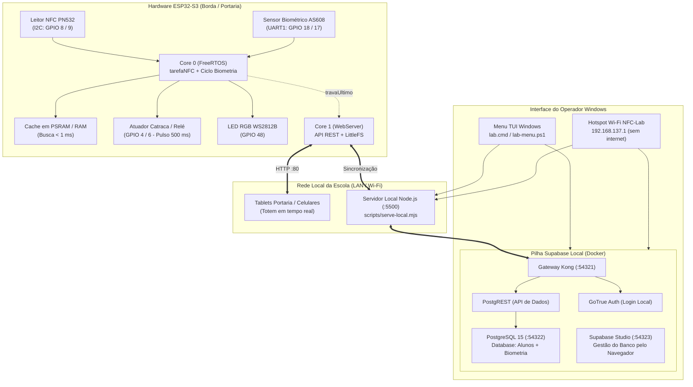

# HANDOFF.md — Estado Técnico, Arquitetura e Continuidade Operacional (`escola-nfc-web-offline`)

## 1. Sumário Executivo do Subsistema

O **`escola-nfc-web-offline`** (vinculado à branch `lab/offline` do repositório `https://github.com/devmagary/escola-nfc-web.git`) constitui uma solução completa, autônoma e à prova de falhas de conectividade externa para controle de acesso, frequência escolar e portaria eletrônica.

O sistema foi desenhado para operar com latência ultrabaixa em ambiente local de borda (Edge / On-Premise), garantindo que a entrada de estudantes, a abertura de catracas/fechaduras e o registro de histórico continuem funcionando com 100% de confiabilidade mesmo sem internet.

### Status Técnico Atual:
- **Estado Geral:** Operacional, homologado e validado em bancada e simulação.
- **Suíte de Testes:** **58 testes automatizados aprovados (0 falhas)** executados com `npm test`.
- **Firmware de Borda:** Versão **v2.1.3 unificada** com cache de alunos em PSRAM, histórico em lote, watchdog de barramento e suporte híbrido nativo a **NFC (PN532)** e **Biometria Óptica (AS608/FPM10A/DY50)**.

---

## 2. Mapa de Arquitetura do Sistema



---

## 3. Especificação de Hardware e Pinagem Oficial (ESP32-S3 N16R8)

O hardware de referência é a placa **YD-ESP32-S3 N16R8** (16 MB Flash Quad SPI, 8 MB Octal PSRAM).

| Periférico | Pino no Periférico | Pino no ESP32-S3 | Função / Protocolo | Observações Técnicas |
| :--- | :--- | :--- | :--- | :--- |
| **PN532 NFC** | `VCC` | `3.3V` (ou `5V`) | Alimentação | 3.3V é o nível lógico nativo recomendado. |
| **PN532 NFC** | `GND` | `GND` | Terra comum | Referência elétrica contínua. |
| **PN532 NFC** | `SDA` | **`GPIO 8`** | I2C Data | Chaves do módulo: **1=ON, 2=OFF**. |
| **PN532 NFC** | `SCL` | **`GPIO 9`** | I2C Clock | Pull-ups internos e rotina de 9 pulsos para recuperação. |
| **Biometria AS608** | `Pino 1 (Vin)` | **`3.3V`** | Alimentação DSP e Prisma | Alimenta o processador DSP Synochip e o LED azul. |
| **Biometria AS608** | `Pino 2 (TX)` | **`GPIO 18`** | Serial Data (Sensor $\rightarrow$ ESP) | Conectado ao `RX` da UART1 (`BIO_RX_PIN`). |
| **Biometria AS608** | `Pino 3 (RX)` | **`GPIO 17`** | Serial Data (ESP $\rightarrow$ Sensor) | Conectado ao `TX` da UART1 (`BIO_TX_PIN`). |
| **Biometria AS608** | `Pino 4 (GND)` | **`GND`** | Terra comum | Referência elétrica comum. |
| **Biometria AS608** | `Pinos 5 e 6` | *Desconectados* | Toque capacitivo | Livres; a varredura óptica é feita pelo Core 0. |
| **LED RGB Onboard**| Integrado | **`GPIO 48`** | WS2812B Addressable | Diagnóstico em tempo real (azul, verde, vermelho, laranja). |
| **Relé / Catraca** | `IN / SIG` | **`GPIO 4`** ou **`6`** | Saída Digital (Active HIGH) | Pulso configurável de 500 ms (`#define PINO_SAIDA`). |

> [!CAUTION]
> **PINOS CRÍTICOS PROIBIDOS:** Os pinos **GPIO 35, 36 e 37** conectam-se internamente à memória Octal PSRAM de 8 MB da placa. Nunca utilize esses pinos para sensores, atuadores ou LEDs, pois o uso causará crash de memória instantâneo.

---

## 4. Inovações do Firmware ESP32 v2.1.3

O firmware unificado [`esp32s3-nfc-acesso.ino`](file:///c:/Users/devma/.gemini/antigravity/scratch/sigeduc-auto/escola-nfc-web-offline/esp32s3-nfc-acesso/esp32s3-nfc-acesso.ino) implementa:

1. **Validação Instantânea com Cache em PSRAM (`cartoesRam`):**
   - Na inicialização, o arquivo `/cartoes.json` é lido da Flash e carregado em uma estrutura indexada em PSRAM.
   - Cada leitura de cartão NFC ou digital realiza uma busca binária/linear em memória RAM, autorizando o acesso em **$< 1\text{ ms}$**.
2. **Buffer Circular de Histórico e Gravação em Lote:**
   - Os últimos 50 eventos de acesso ficam em um ring buffer em RAM.
   - A gravação na SPI Flash é postergada e executada em bloco somente quando o fluxo de alunos para (3 segundos sem passagem) ou antes de um reinício/OTA, eliminando o congelamento de ~386 ms por validação.
3. **Protocolo Synochip Óptico Nativo (Sem Bibliotecas de Terceiros):**
   - Comunicação serial direta via pacotes binários (`0xEF01`) na UART1 a `57600 bps`.
   - Suporta posições de template de `1` a `300`.
   - Máquina de estados não-bloqueante para cadastro em 2 etapas com confirmação de prisma e remoção de dedo intermediária.
4. **Watchdog de Barramento e Auto-Cura:**
   - Heartbeat a cada 2 segundos. Se o barramento I2C travar ou o PN532 sofrer ruído estático, o firmware executa `reiniciarLeitorCompleto()` (liberação forçada com 9 pulsos de clock, reinício de Wire e verificação de `SAMConfig` com 3 tentativas).

---

## 5. Modalidades de Identificação do Estudante

O sistema unifica a identificação escolar em três modalidades sem qualquer conflito:

| Modalidade | Identificador Primário | Identificador Secundário | Comportamento no Totem e Portaria |
| :--- | :--- | :--- | :--- |
| **A. Somente NFC** | Cartão Físico (`04:A1:B2:C3`) | N/A | Exibe badge `NFC` e abre a ficha do aluno ao aproximar o cartão. |
| **B. Somente Biometria** | Template Óptico (Posição `1..300`) | UID Virtual (`FB:10:00:07`) | Exibe badge `👆 Bio #7` e abre a ficha do aluno com foto e turma ao encostar o dedo. |
| **C. Híbrido (Ambos)** | Cartão Físico (`04:A1:B2:C3`) | Template Óptico (Posição `1..300`) | O aluno pode usar qualquer um dos dois indistintamente. A portaria identifica o método (`"nfc"` ou `"biometria"`). |

---

## 6. Endpoints REST da Borda (ESP32)

| Rota | Método | Função | Payload / Resposta |
| :--- | :---: | :--- | :--- |
| `/api/ultimo` | `GET` | Retorna o último acesso com contador de sequência | `{"seq":14,"uid":"...","nome":"...","metodo":"biometria","bio_id":7,"ha":0}` |
| `/api/status` | `GET` | Status geral, diagnósticos de memória, Wi-Fi e sensores | `{"nfc":true,"bio":true,"psram_livre":...,"cartoes_ram":...}` |
| `/api/biometria/iniciar` | `POST` | Inicia cadastro guiado na posição `id` | `{"id": 7}` $\rightarrow$ `{"ok":true,"etapa":"aguardando_dedo_1"}` |
| `/api/biometria/status` | `GET` | Consulta a etapa da máquina de estados biométrica | `{"ativo":true,"etapa":"retire_o_dedo","mensagem":"..."}` |
| `/api/biometria/cancelar`| `POST` | Cancela imediatamente o cadastro em andamento | `{"ok": true, "cancelado": true}` |
| `/api/biometria/excluir` | `POST` | Exclui o template biométrico da Flash do sensor | `{"id": 7}` $\rightarrow$ `{"ok": true, "removido": true}` |
| `/api/sincronizar_aluno`| `POST` | Atualiza ou insere um aluno na Flash e RAM | `{"uid":"...","nome":"...","bio_id":7,"ativo":true}` |
| `/api/sincronizar_todos`| `POST` | Sobrescreve a base completa em lote | Array JSON com todos os alunos do banco |
| `/api/remover_aluno` | `POST` | Remove um aluno da memória local | `{"uid": "..."}` |

---

## 7. Inventário de Arquivos do Repositório Offline

### 7.1 Automação e Ferramentas de Terminal Windows
- `lab.cmd`: Atalho de execução para `lab-menu.ps1`.
- `lab-menu.ps1`: Menu TUI de 24 linhas para ligar/desligar Docker, monitorar serviços, alternar o hotspot e abrir portais.
- `lab-estado.ps1`: Daemon de checagem periódica das portas de rede (54321, 54322, 54323, 5500, 8080) e do hotspot.
- `lab-hotspot.ps1` / `lab-hotspot.cmd` / `lab-hotspot-desligar.cmd`: Criam/desligam a rede Wi-Fi `NFC-Lab` em `192.168.137.1` sem internet.
- `lab-ligar.cmd`: Script em lote para inicialização rápida da pilha Supabase e servidor local.
- `lab-desligar.cmd`: Encerramento seguro de contêineres Docker.
- `lab-checar.cmd`: Diagnóstico instantâneo de conectividade e integridade.
- `lab-firewall-liberar.cmd`: Criação de regras de firewall para as portas do laboratório (Wi-Fi, cabo e hotspot).
- `lab-criar-atalhos.cmd` / `lab-atalhos.ps1`: Criação de atalhos no Desktop do operador ("Servidor NFC" e "Hotspot NFC").

### 7.2 Scripts Node.js (`scripts/`)
- `scripts/serve-local.mjs`: Servidor HTTP de arquivos estáticos e proxy local (porta 5500).
- `scripts/network.mjs`: Escolha do IP do notebook, ignorando interfaces virtuais e priorizando o hotspot.
- `scripts/lab-setup.mjs`: Configuração automática de IP da rede e variáveis no `.env.local`.
- `scripts/check-lab.mjs`: Validador de portas, contêineres e credenciais.
- `scripts/mock-esp.mjs`: Simulador completo do ESP32 para desenvolvimento sem hardware físico (porta 8080).

### 7.3 Banco de Dados Supabase Local (`supabase/`)
- `supabase/config.toml`: Configuração do ambiente local (portas, pooler, auth, studio).
- `supabase/migrations/20261110_biometria_opcional.sql`: Adiciona coluna `biometria_id` e índice único parcial.
- `supabase/seed.sql`: Carga de dados simulados (alunos em modo NFC, biometria e híbrido).
- `supabase_setup.sql`: Script DDL consolidado para inicialização manual se necessário.

### 7.4 Frontend Web do Painel e Portaria (`js/`, `index.html`, `style.css`)
- `index.html`: Interface do Totem da Portaria, Lista de Alunos e Modal de Cadastro Biométrico guiado.
- `js/app.js`: Controlador principal com polling inteligente para `/api/ultimo` e fluxo guiado de biometria.
- `js/services/esp32.js`: Cliente HTTP do firmware com suporte a todas as rotas `/api/biometria/*`.
- `js/services/supabase.js`: Camada de dados com busca integrada por UID e `biometria_id`.
- `js/lib/utils.js`: Funções de validação, normalização e conversão de UID virtual.

### 7.5 Firmware do ESP32-S3 (`esp32s3-nfc-acesso/`)
- `esp32s3-nfc-acesso.ino`: Firmware v2.1.3 completo.
- `pagina_web.h`, `pagina_wifi.h`, `web_ferramentas.h`: Páginas web e utilitários embutidos.
- `MANUAL_DO_SISTEMA.md` e `GUIA_DE_PINOS_E_EXPANSAO.md`: Documentação técnica de hardware e montagem.

---

## 8. Verificação e Suíte de Testes Automatizados

O repositório inclui **58 testes unitários e de integração** executados sem dependências externas (`node --test tests/`):
- `tests/biometria.test.mjs`: Valida normalização de IDs (1..300), UID virtual bidirecional e simulação mock.
- `tests/index.mjs` e suítes existentes: Validação de telefones, parsing CSV, proteção de senhas, injeção de configuração, URLs Supabase e CSP local (zero CDN).

```bash
# Execução da suíte
npm test
```
**Resultado:** `tests: 58 | pass: 58 | fail: 0 (100% de aprovação)`.

---

## 9. Instruções de Continuidade para Novos Desenvolvedores / Agentes

1. **Antes de editar qualquer código de hardware:** Consulte a seção 3 deste documento para não conflitar com a PSRAM Octal nos pinos 35, 36 e 37.
2. **Ambiente de Desenvolvimento sem Placa Física:** Execute `npm run mock:esp` em um terminal e `npm run lab:dev` em outro. O sistema se comportará como se o ESP32 real estivesse na porta 8080 com suporte total a cartões e digitais simuladas.
3. **Deploy de Firmware na Placa:** Use a Arduino IDE ou `arduino-cli` com a placa selecionada `ESP32S3 Dev Module`, opção `PSRAM: OPI PSRAM`, `Flash Size: 16MB` e `Partition Scheme: 16MB with LittleFS`.
4. **Antes de Comitar:** Sempre execute `npm test` e `npm run check`.
